# Báo cáo project nhóm
## Project Overview
Đây là project của nhóm 7 làm một website với file html

## Team members
25127127 - Nguyễn Minh Quang 
25127206 - Nguyễn Đình Hoàng Lân 
25127307 - Nguyễn Trí Dũng 
25127109 - Phạm Ngọc Bình Nguyên 
25127011 - Đặng Đức Anh 
23127460 - Lê Đình Minh Quân

## Links
Github Repository: https://github.com/nmquang2530/Group-7-html-website/
Github Pages: https://nmquang2530.github.io/Group-7-html-website/

## Đóng góp thành viên
| Member | Assigned Tasks | Contributions | 
| --- | --- | --- | 
| Nguyễn Minh Quang  | 1, 3, 6 | Work Completed | 
| Nguyễn Đình Hoàng Lân | lorem ipsum | lorem ipsum |
| Nguyễn Trí Dũng | 2 | Complete contact page |
| Phạm Ngọc Bình Nguyên | Activities page | Complete activities.html + create feature branch and Pull Request |
| Đặng Đức Anh | lorem ipsum | lorem ipsum |
| Lê Đình Minh Quân | Home page, Task 2, 3, 4, 5, 7 | Hoàn thiện trang chủ `index.html` trên nhánh `feature/home-page` (3 commits, [PR #1](https://github.com/nmquang2530/Group-7-html-website/pull/1)); phối hợp tạo & giải quyết Merge Conflict ở Task 4 ([PR #8](https://github.com/nmquang2530/Group-7-html-website/pull/8)); thực hiện `git revert` commit lỗi `c17d74d` ở Task 5 ([`afbb84a`](https://github.com/nmquang2530/Group-7-html-website/commit/afbb84a)); cập nhật minh chứng Task 4, 5 và phần đóng góp cá nhân trong `docs/REPORT.md` |

## Evidence Các Task
### Task 1: Setting Up the Repository and Managing Commits
Work: Tạo ra repository và set up các file cơ bản: README.md, .gitnore, CHANGELOG.md
Evidence:  
Result: Thành công tạo ra Repository

### Task 2: Working with Branches
Work (Dũng): tạo contact branch và merge vào main
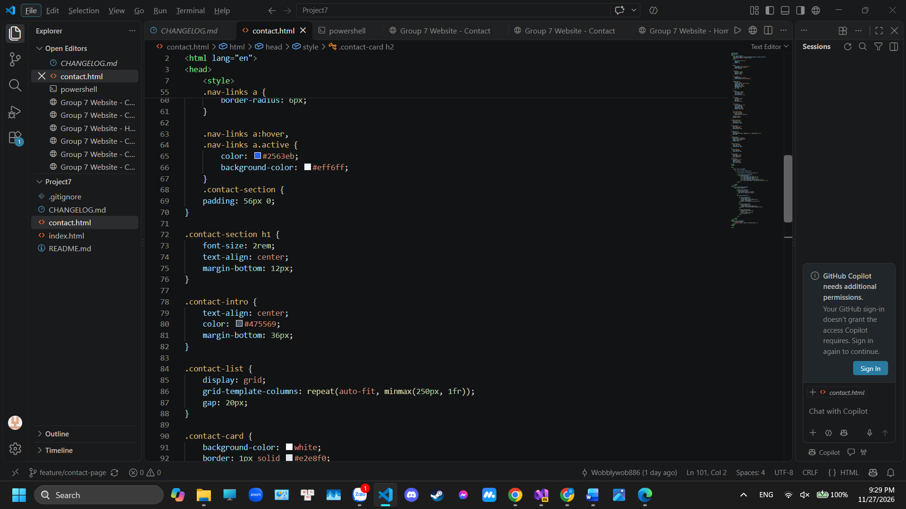.
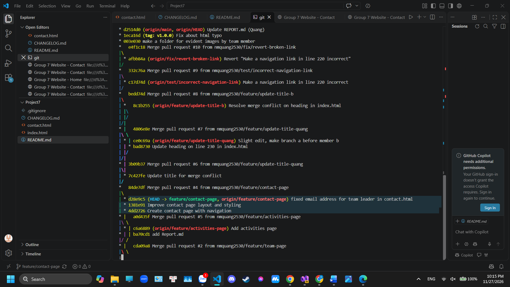.

### Task 3: Collaborating with Pull Requests
Work: Tạo các pull request và comment đánh giá
Evidence: 
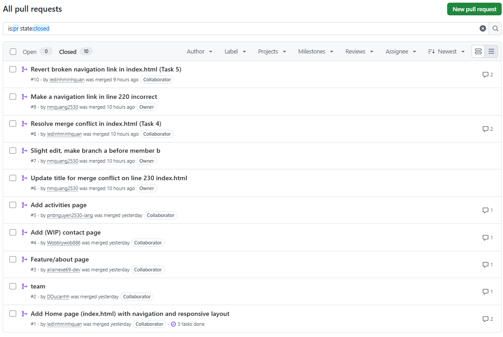

Result: thành công đánh giá và merge nhánh lên main

### Task 4: Resolving a Merge Conflict
Work: Phối hợp giữa Nguyễn Minh Quang (`feature/update-title-quang`, commit [`ce0c69a`](https://github.com/nmquang2530/Group-7-html-website/commit/ce0c69a)) và Lê Đình Minh Quân (`feature/update-title-b`, commit [`bad8730`](https://github.com/nmquang2530/Group-7-html-website/commit/bad8730)) cùng chỉnh sửa tiêu đề `<h1>` tại dòng 230 của file `index.html` từ cùng một commit gốc. Sau khi nhánh của Quang được merge vào `main` qua [PR #7](https://github.com/nmquang2530/Group-7-html-website/pull/7), Quân chạy `git fetch origin` và `git merge origin/main` để kích hoạt merge conflict, xử lý trực tiếp trên VS Code (chọn giữ tiêu đề thống nhất `<h1>Welcome to Group 7 HTML Website</h1>`), commit giải quyết ([`8c1b255`](https://github.com/nmquang2530/Group-7-html-website/commit/8c1b255)) và merge vào `main` qua [PR #8](https://github.com/nmquang2530/Group-7-html-website/pull/8).
Evidence:
- Pull Requests: [PR #7](https://github.com/nmquang2530/Group-7-html-website/pull/7), [PR #8](https://github.com/nmquang2530/Group-7-html-website/pull/8)
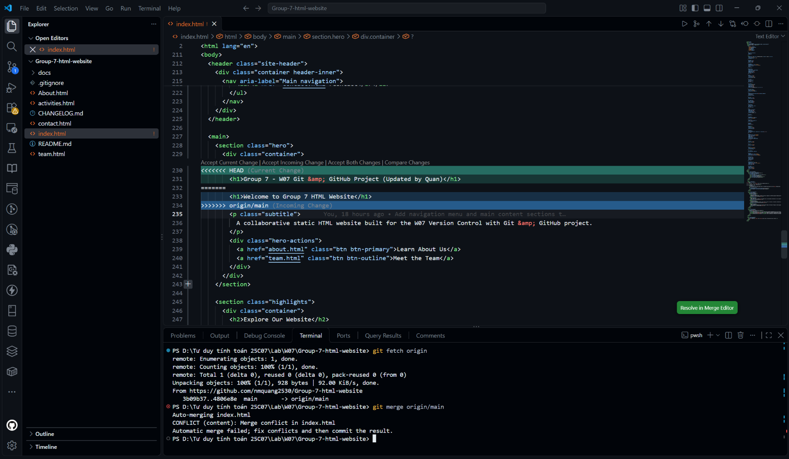
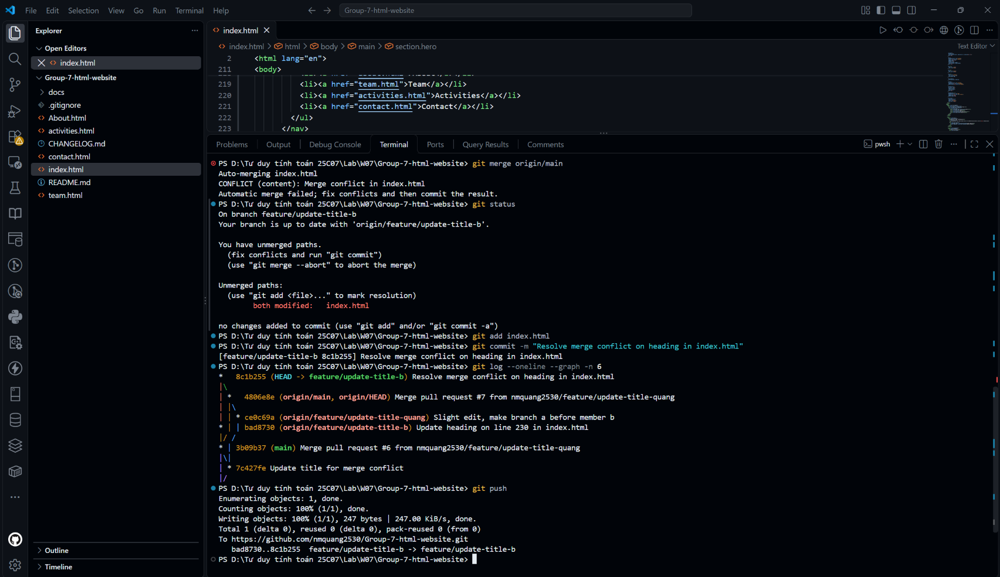
Result: Giải quyết thành công merge conflict mà không ghi đè lịch sử Git, trang `index.html` trên nhánh `main` hiển thị ổn định.

### Task 5: Reverting a Commit
Work: Nguyễn Minh Quang cố tình tạo commit lỗi [`c17d74d`](https://github.com/nmquang2530/Group-7-html-website/commit/c17d74d) trên nhánh `test/incorrect-navigation-link` (sửa sai link điều hướng ở dòng 220 file `index.html` từ `activities.html` thành `activites.html`) và merge vào `main` qua [PR #9](https://github.com/nmquang2530/Group-7-html-website/pull/9). Lê Đình Minh Quân kiểm tra lịch sử bằng `git log` và `git show c17d74d` để xác định commit lỗi, tạo nhánh `fix/revert-broken-link` và dùng `git revert c17d74d` tạo commit hoàn tác [`afbb84a`](https://github.com/nmquang2530/Group-7-html-website/commit/afbb84a), sau đó mở Pull Request merge vào `main`.
Evidence:
- Commit lỗi: [`c17d74d`](https://github.com/nmquang2530/Group-7-html-website/commit/c17d74d) ([PR #9](https://github.com/nmquang2530/Group-7-html-website/pull/9))
- Commit hoàn tác (revert): [`afbb84a`](https://github.com/nmquang2530/Group-7-html-website/commit/afbb84a)
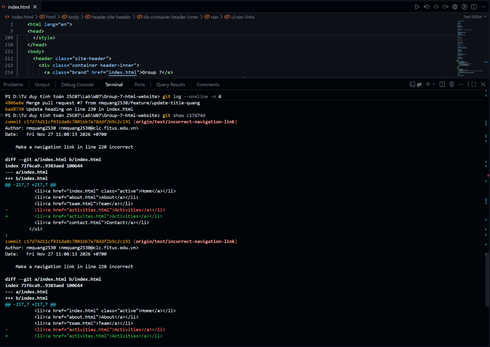
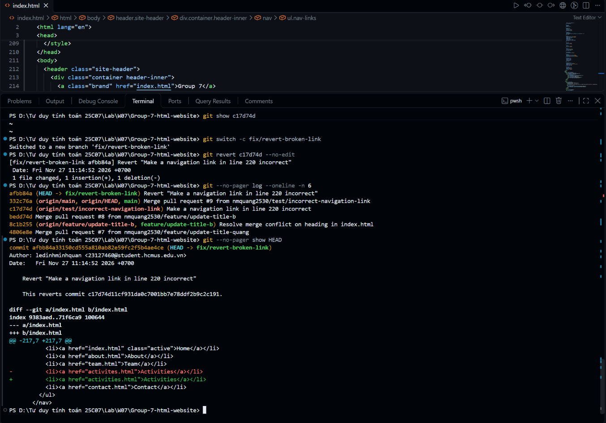
Result: Khôi phục thành công đường dẫn `activities.html` bằng `git revert`, giữ nguyên lịch sử commit và kiểm tra lại thanh điều hướng hoạt động bình thường.

### Task 6: Preparing a Release and Deploying the Website
Work: hoàn thành website và release project
Evidence: 
Result: thành công publish trang web

### Activities Page – Phạm Ngọc Bình Nguyên (25127109)
Work: Tạo trang Activities (`activities.html`), tạo branch `feature/activities-page` và Pull Request.
Evidence:
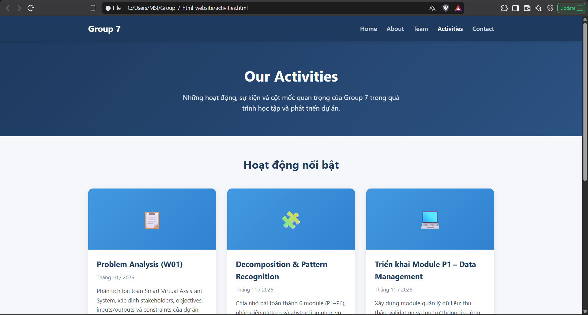
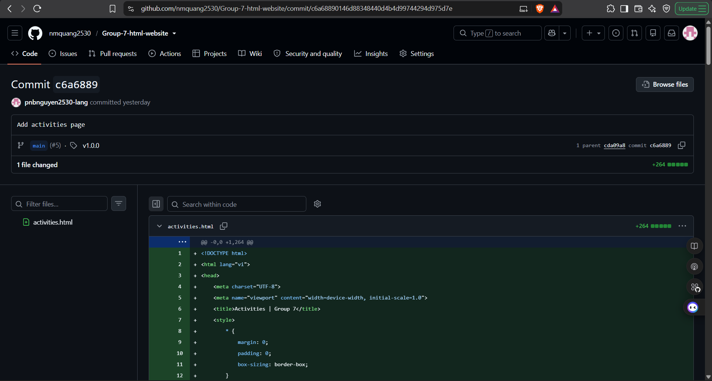
Result: Thành công tạo trang Activities và merge vào main

### Home Page – Lê Đình Minh Quân (23127460)
Work: Tạo trang chủ Home (`index.html`) kèm thanh điều hướng liên kết 5 trang và giao diện CSS responsive trên nhánh `feature/home-page` (3 commits có ý nghĩa), sau đó mở [PR #1](https://github.com/nmquang2530/Group-7-html-website/pull/1) để review và merge vào `main`.
Evidence:
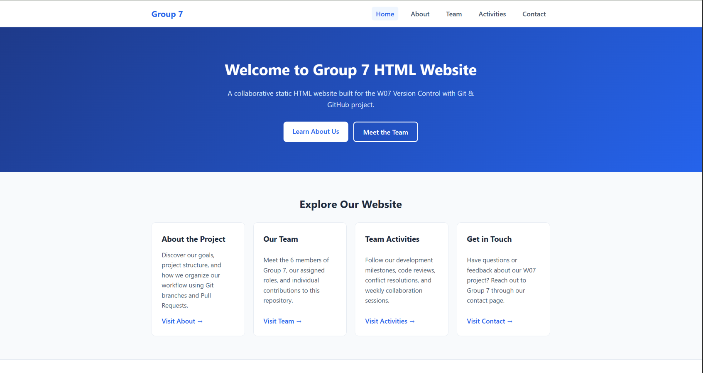
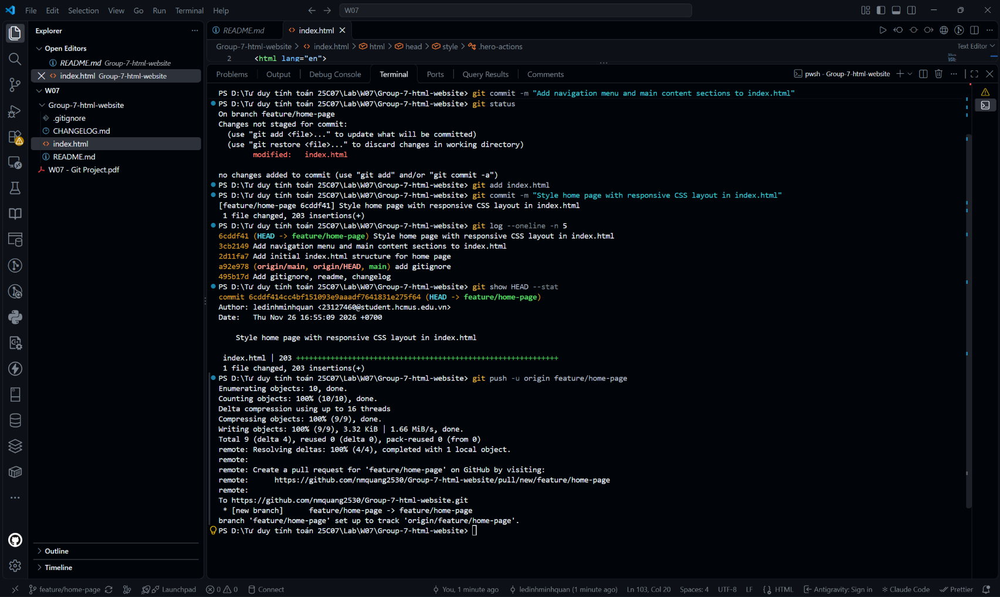
Result: Thành công tạo trang chủ `index.html` và merge vào `main`, hiển thị ổn định trên GitHub Pages.