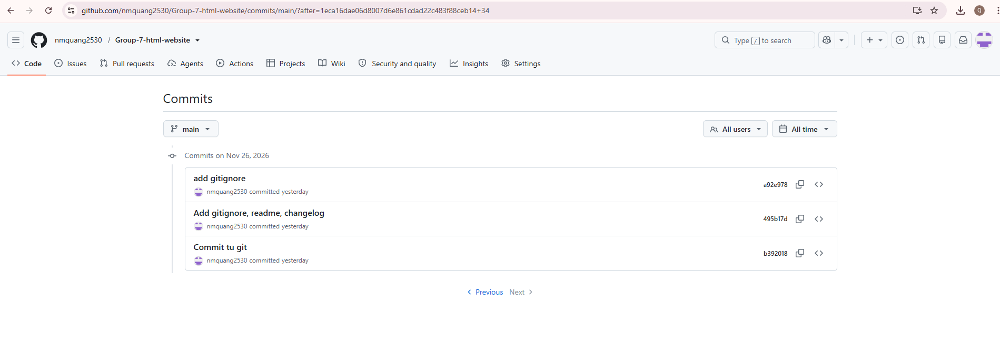
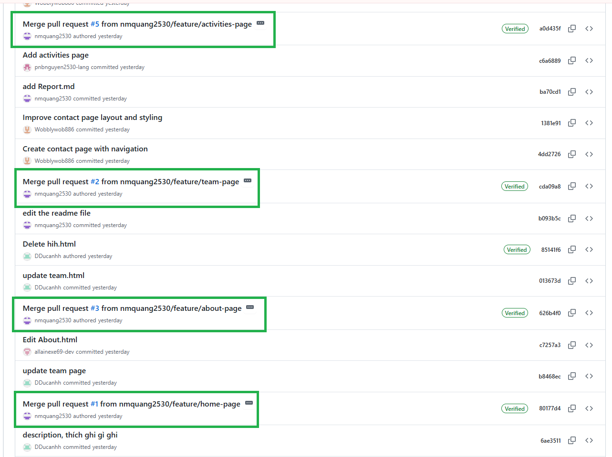
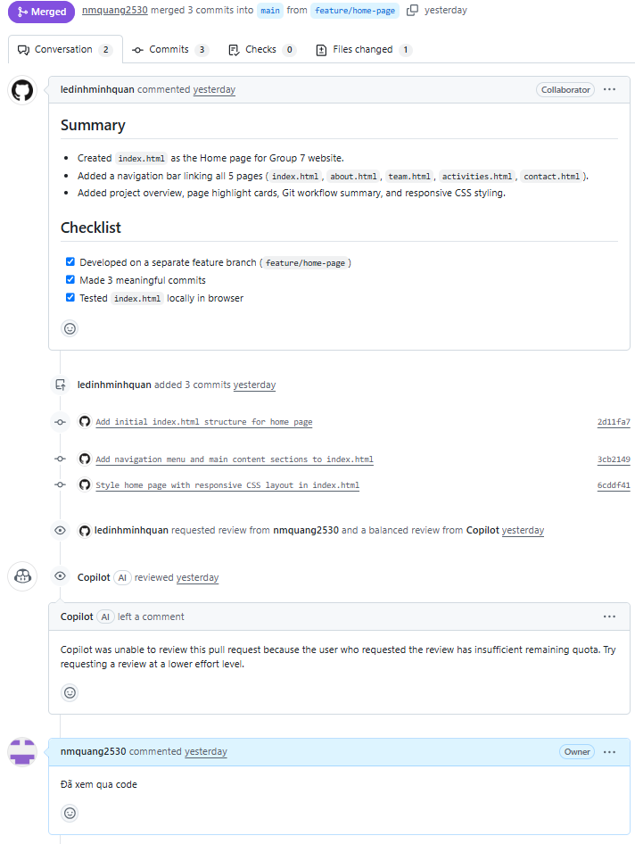
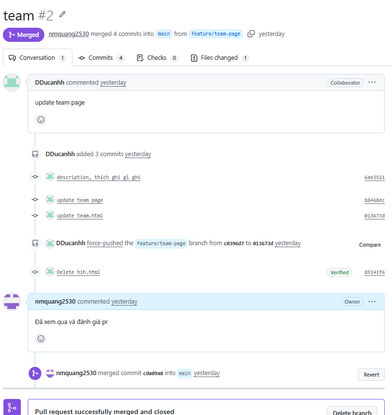
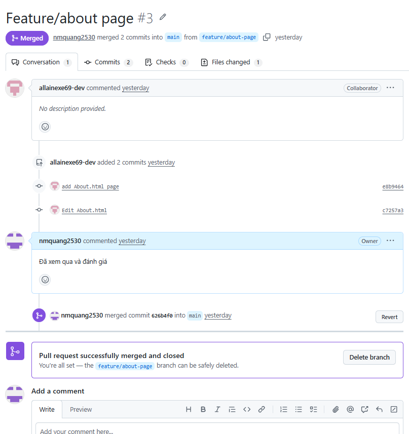
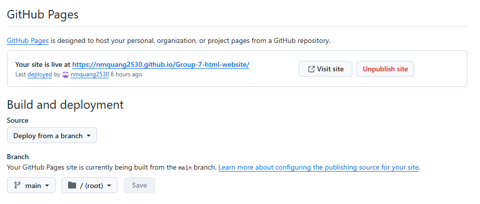

# Báo cáo project nhóm
## Project Overview
Đây là project của nhóm 7 làm một website với file html

## Team members
25127127 - Nguyễn Minh Quang 
25127206 - Nguyễn Đình Hoàng Lân 
25127307 - Nguyễn Trí Dũng 
25127109 - Phạm Ngọc Bình Nguyên 
25127011 - Đặng Đức Anh 
23127460 - Lê Đình Minh Quân

## Links
Github Repository: https://github.com/nmquang2530/Group-7-html-website/
Github Pages: https://nmquang2530.github.io/Group-7-html-website/

## Đóng góp thành viên
| Member | Assigned Tasks | Contributions | 
| --- | --- | --- | 
| Nguyễn Minh Quang  | 1, 3, 6 | Work Completed | 
| Nguyễn Đình Hoàng Lân | lorem ipsum | lorem ipsum |
| Nguyễn Trí Dũng | 2 | Complete contact page |
| Phạm Ngọc Bình Nguyên | lorem ipsum | lorem ipsum |
| Đặng Đức Anh | lorem ipsum | lorem ipsum |
| Lê Đình Minh Quân | lorem ipsum | lorem ipsum |

## Evidence Các Task
### Task 1: Setting Up the Repository and Managing Commits
Work: Tạo ra repository và set up các file cơ bản: README.md, .gitnore, CHANGELOG.md
Evidence:  
Result: Thành công tạo ra Repository

### Task 2: Working with Branches
Work (Dũng): tạo contact branch và merge vào main
.
.
### Task 3: Collaborating with Pull Requests
Work: Tạo các pull request và comment đánh giá
Evidence: 

Result: thành công đánh giá và merge nhánh lên main

### Task 4: Resolving a Merge Conflict

### Task 5: Reverting a Commit

### Task 6: Preparing a Release and Deploying the Website
Work: hoàn thành website và release project
Evidence: 
Result: thành công publish trang web

